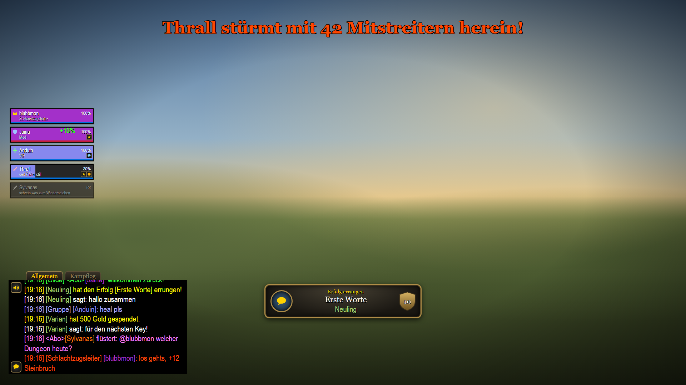
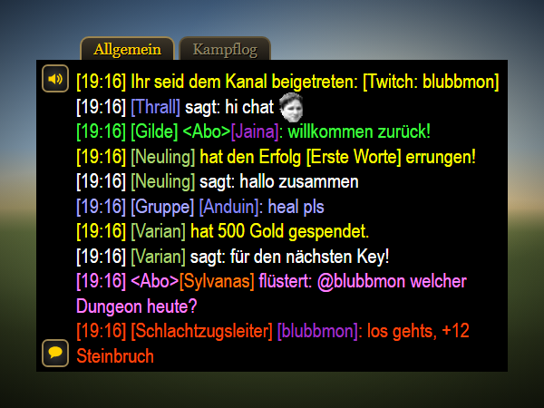
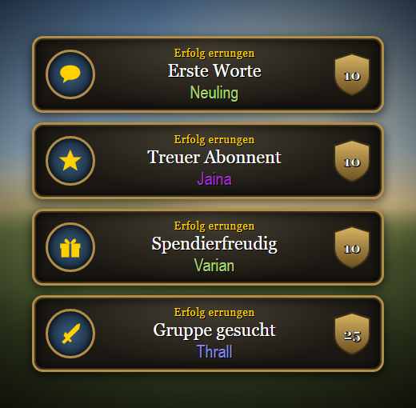
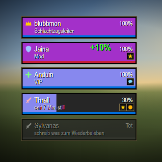
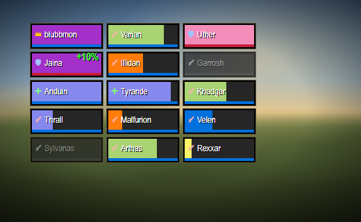
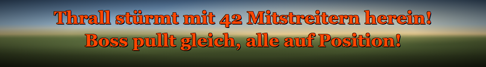
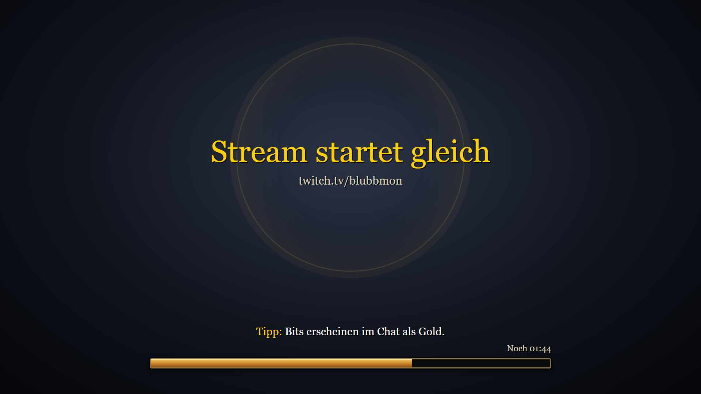
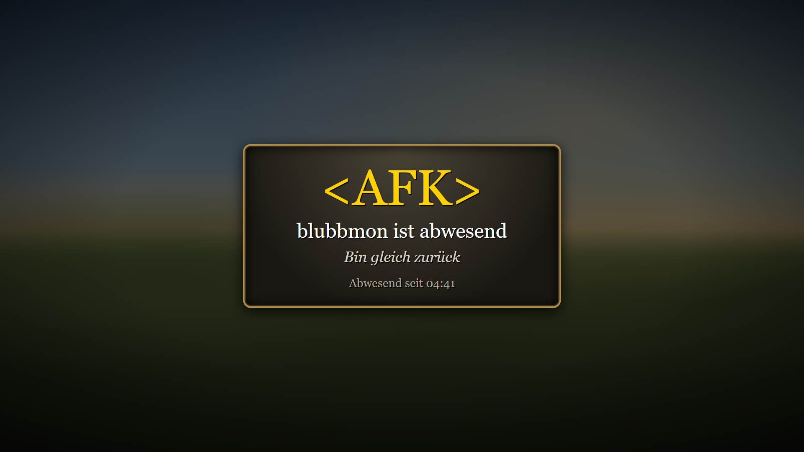

# WoW-Overlays für Twitch

Dein Twitch-Chat im Stil von World of Warcraft: als WoW-Chatfenster, mit Erfolgen, einem Gruppenfenster aus deinen Zuschauern und passenden Start- und Pausenbildschirmen. Für Streamlabs und OBS, ohne Login und ohne Server.

<p align="center">
  
  <br><sub>Beispielszene. Der Hintergrund ist ein Platzhalter, im Stream liegt dort dein Spiel.</sub>
</p>

## Was dabei ist

### Chat



Jede Twitch-Rolle bekommt einen WoW-Chatkanal. Mods schreiben im Gildenchat, VIPs im Gruppenchat und du als Schlachtzugsleiter. Wer dich mit `@deinkanal` anspricht, erscheint rosa als Flüstern.

Namen tragen feste Klassenfarben. Bits erscheinen als Gold. Emotes von Twitch, 7TV, BetterTTV und FrankerFaceZ werden als Bilder angezeigt. Löscht ein Mod eine Nachricht, verschwindet sie auch im Overlay.

<br clear="right">

### Erfolge



Bei besonderen Ereignissen erscheint ein Popup wie bei einem WoW-Erfolg, dazu eine gelbe Zeile im Chat.

| Erfolg | Auslöser | Punkte |
|---|---|---|
| Erste Worte | allererste Nachricht einer Person in deinem Kanal | 10 |
| Treuer Abonnent | Sub oder Resub | 10 |
| Spendierfreudig | Abo-Geschenk, ein Erfolg pro Geschenk-Aktion | 10 |
| Gruppe gesucht | Raid auf deinen Kanal | 25 |
| Goldesel | ab 1000 Bits in einer Nachricht | 25 |
| Gesprächig | 100. Nachricht einer Person | 10 |
| Stammgast | 1000. Nachricht einer Person | 25 |

<br clear="right">

### Gruppenfenster

<p>
  
  
</p>

Du stehst oben mit Krone, darunter die zuletzt aktiven Chatter. Mods sind Tanks, VIPs Heiler, alle anderen Schadensverursacher.

- Wer nichts schreibt, verliert langsam Leben und ist nach 10 Minuten tot. Eine neue Nachricht heilt mit grüner Heilzahl oder belebt wieder.
- Buff-Symbole zeigen Abo, Erstschreiber und Bits.
- Ab 6 Personen wird aus der Gruppe ein Schlachtzug mit kleinen Rahmen, bis zu 20.

### Schlachtzugswarnung



Bei einem Raid erscheint gross und rot, wer mit wie vielen Leuten hereinkommt. Du und deine Mods könnt die Warnung auch selbst auslösen: `!rw Boss pullt gleich!`

### Lade- und AFK-Bildschirm

<p>
  
  
</p>

Der Ladebildschirm zeigt deinen Titel, wechselnde Tipps und einen Ladebalken, der bis zum Streamstart voll läuft. Der AFK-Bildschirm dunkelt das Spiel ab und zählt, wie lange du schon weg bist.

## Schnellstart

1. Oben auf **Code** → **Download ZIP** klicken, entpacken und den Ordner an einen festen Platz legen, z. B. `C:\Overlays\wow`. Alle Dateien müssen zusammen bleiben.
2. `config.js` mit einem Texteditor öffnen und deinen Twitch-Kanal eintragen, ohne `#`:
   ```js
   channel: 'deinkanal',
   ```
3. In Streamlabs oder OBS für jedes Overlay eine **Browserquelle** anlegen, den Haken bei **Lokale Datei** setzen und die HTML-Datei wählen. Grösse aus der Tabelle eintragen und die Quelle über die Spielaufnahme legen.

| Datei | Overlay | Grösse |
|---|---|---|
| `index.html` | Chat | 500 × 290 |
| `erfolg.html` | Erfolgs-Popup | 480 × 130 |
| `gruppe.html` | Gruppenfenster | 440 × 260 |
| `raidwarnung.html` | Schlachtzugswarnung | 1600 × 220 |
| `laden.html` | Ladebildschirm, eigene Szene | 1920 × 1080 |
| `afk.html` | AFK-Bildschirm | 1920 × 1080 |

Nach einer Änderung an `config.js` klickst du in jeder Quelle auf **Cache der aktuellen Seite aktualisieren**.

Die Overlays lesen den öffentlichen Chat mit, so wie ein ausgeloggter Zuschauer auf twitch.tv. Du brauchst kein Twitch-Login und keinen Token, und die Overlays können nichts in deinen Chat schreiben.

## Einstellungen

Alle Einstellungen stehen in `config.js`:

| Einstellung | Standard | Wirkung |
|---|---|---|
| `channel` | `'blubbmon'` | Twitch-Kanal, den alle Overlays mitlesen |
| `size` | `22` | Schriftgrösse im Chat in Pixel |
| `bg` | `1` | Deckkraft des schwarzen Chat-Hintergrunds, von `0` (durchsichtig) bis `1` (voll schwarz) |
| `fade` | `120` | Sekunden, bis eine Chatzeile ausblendet. `0` heisst nie. |
| `lines` | `50` | So viele Chatzeilen bleiben höchstens gespeichert |
| `time` | `true` | Uhrzeit vor jeder Chatzeile. `false` blendet sie aus. |
| `bits` | `1000` | Ab so vielen Bits in einer Nachricht gibt es den Erfolg „Goldesel“ |
| `dead` | `10` | Minuten ohne Nachricht, bis jemand im Gruppenfenster tot ist |
| `raid` | `20` | So viele Rahmen zeigt das Gruppenfenster höchstens. `5` heisst immer nur Gruppe. |
| `title` | `'Stream startet gleich'` | Überschrift des Ladebildschirms |
| `countdown` | `5` | Minuten bis zum Start auf dem Ladebildschirm |
| `tips` | 5 Tipps | Tipps, die der Ladebildschirm alle 10 Sekunden wechselt |
| `afk` | `'Bin gleich zurück'` | Text auf dem AFK-Bildschirm |

Einzelne Werte kannst du auch nur für eine Quelle ändern. Dafür den Haken bei **Lokale Datei** entfernen und als URL den Dateipfad mit Zusatz eintragen, z. B. `file:///C:/Overlays/wow/index.html?size=18&bg=0.8`. Leerzeichen im Pfad schreibst du als `%20`. Möglich sind `channel`, `size`, `bg`, `fade`, `lines`, `time=0`, im Gruppenfenster `dead` und `raid` und im Ladebildschirm `countdown`.

## Details

### Chatkanäle

| Twitch | Darstellung im Chat |
|---|---|
| Zuschauer | weiss: `[Name] sagt: …` |
| Mod | grün: `[Gilde] [Name]: …` |
| VIP | blau: `[Gruppe] [Name]: …` |
| Streamer | orange: `[Schlachtzugsleiter] [Name]: …` |
| Nachricht mit `@deinkanal` | rosa: `[Name] flüstert: …` |
| `/me`-Nachricht | orange wie ein WoW-Emote |
| Sub, Raid, Bits und Erfolge | gelb wie eine Systemmeldung |

Abonnenten tragen ein `<Abo>` vor dem Namen. Bei Cheers verschwinden die Wörter wie `Cheer100` aus der Nachricht, davor steht `[Name] hat 100 Gold gespendet.` Verschenkt jemand mehrere Subs auf einmal, zeigt der Chat nur die Sammelmeldung. Die Emote-Listen von 7TV, BetterTTV und FrankerFaceZ lädt der Chat beim Start einmal.

### Erfolge

Kommen mehrere Erfolge gleichzeitig, zeigt das Popup sie nacheinander. Die Regeln stehen in `twitch.js` in der Funktion `achievementOf`.

Für „Gesprächig“ und „Stammgast“ zählen die Overlays die Nachrichten jeder Person im Browser-Speicher von Streamlabs. Gezählt wird ab dem ersten Einsatz. Wird der Speicher von Streamlabs gelöscht, beginnt die Zählung von vorn. Bots wie Nightbot zählen nicht.

### Gruppenfenster

Wer doppelt so lange still ist wie bis zum Tod, verlässt die Gruppe. So schrumpft ein Schlachtzug von selbst wieder, wenn es im Chat ruhig wird. Bots wie Nightbot oder StreamElements kommen nicht hinein. Wer gebannt oder getimeoutet wird, fliegt raus.

### Lade- und AFK-Bildschirm

Damit der Countdown beim Einblenden neu beginnt, schaltest du in der Quelle des Ladebildschirms **Browser aktualisieren, wenn Szene aktiv wird** ein. Beim AFK-Bildschirm sorgt **Quelle herunterfahren, wenn nicht sichtbar** dafür, dass „Abwesend seit“ jedes Mal bei null beginnt.

## Testen ohne Chat

Zu den Live-Overlays gibt es Testversionen mit Beispielnachrichten: `index-test.html`, `erfolg-test.html`, `gruppe-test.html` und `raidwarnung-test.html`. Wähle sie zum Platzieren als **Lokale Datei** aus und stelle danach wieder auf die normale Datei um. Im Test-Gruppenfenster ist man schon nach 1 Minute tot, damit du alle Zustände schnell siehst.

## Dateien

| Datei | Inhalt |
|---|---|
| `config.js` | deine Einstellungen |
| `twitch.js` | Verbindung zum Twitch-Chat und Regeln für Erfolge |
| `emotes.js` | lädt die Emotes von 7TV, BetterTTV und FrankerFaceZ |
| `index.html`, `erfolg.html`, `gruppe.html`, `raidwarnung.html`, `laden.html`, `afk.html` | die Overlays |
| `*-test.html` | Testversionen mit Beispielnachrichten |
| `docs/images/` | Bilder für diese Seite |

Schriften, Rahmen und Symbole sind nachgebaut. Grafiken von Blizzard sind nicht enthalten. Die Chatschrift ist Arial Narrow. Fehlt sie auf dem PC, lädt das Overlay Roboto Condensed von Google Fonts. World of Warcraft ist eine Marke von Blizzard Entertainment. Dieses Projekt steht in keiner Verbindung zu Blizzard.
